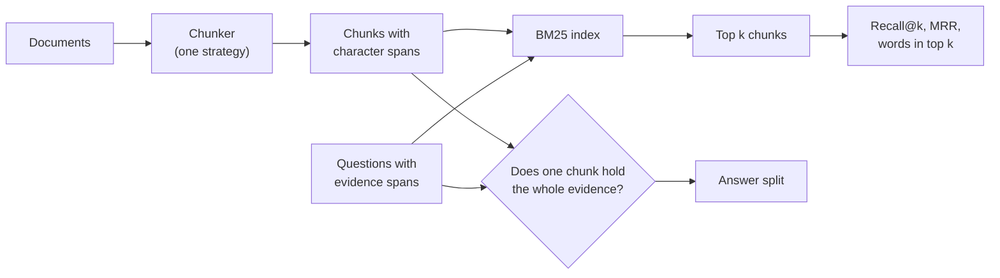

# chunkaudit

[](https://github.com/Vishal-Krishna-Kumar/chunkaudit/actions/workflows/ci.yml)
[](LICENSE)


**Is your chunker cutting the answer in half?**

chunkaudit compares RAG chunking strategies on your documents and tells you two things for each one: how often it splits the text that answers a question across two chunks, and whether retrieval still finds a chunk with the whole answer. It runs offline in seconds. No API key, no model download, one dependency (NumPy).

```
pip install git+https://github.com/Vishal-Krishna-Kumar/chunkaudit.git
chunkaudit demo
```


That is the bundled sample: 5 short articles and 20 questions. Fixed 40-word chunks cut the answer in 12 of 20 questions, and no retriever can recover an answer that no chunk contains.

The recording is generated from the real output of the command by `scripts/make_demo_gif.py`. The colours on the "Answer split" column are added by that script; the terminal output itself is plain text.

## Results on SQuAD v1.1

The same audit on a real dataset: the SQuAD v1.1 development set, with the paragraphs of each Wikipedia article joined into one long document. That gives 48 documents of about 5,300 words each and 10,570 questions. The evidence of a question is the sentence that contains the answer. All nine default strategies ran in 13 seconds on a laptop.


The same numbers as a table:

| Strategy | Chunks | Avg words | Answer split | Recall@1 | Recall@3 | Recall@5 | MRR@10 | Words in top 5 |
|---|---:|---:|---:|---:|---:|---:|---:|---:|
| `sentence:10:2` | 1,283 | 245 | 0.0% | 75.4% | 89.1% | 92.5% | 0.828 | 1,258 |
| `paragraph:200` | 1,687 | 150 | 0.0% | 75.3% | 88.3% | 91.6% | 0.824 | 777 |
| `recursive:200` | 1,734 | 146 | 0.0% | 74.6% | 88.0% | 91.3% | 0.819 | 753 |
| `sentence:5:1` | 2,554 | 124 | 0.0% | 72.6% | 86.2% | 89.8% | 0.801 | 633 |
| `fixed:200:50` | 1,701 | 198 | 1.1% | 69.0% | 86.1% | 90.2% | 0.783 | 995 |
| `fixed:400` | 658 | 386 | 6.8% | 70.4% | 84.1% | 87.5% | 0.778 | 1,974 |
| `sentence:3` | 3,419 | 74 | 0.1% | 68.0% | 82.1% | 86.0% | 0.758 | 378 |
| `fixed:200` | 1,292 | 196 | 14.1% | 63.1% | 75.6% | 78.7% | 0.699 | 994 |
| `fixed:100` | 2,561 | 99 | 29.0% | 50.5% | 60.0% | 62.6% | 0.558 | 499 |

What the numbers say:

- **Fixed-size chunks without overlap cut a lot of answers.** At 100 words the answering sentence is split in 29.0% of questions, at 200 words in 14.1%. Recall@5 for `fixed:200` is 78.7%, against 91.3% for `recursive:200`, which also sends fewer words to the model (753 against 994).
- **A small overlap fixes most of it, and more overlap adds nothing.** For 200-word chunks:

  | Overlap | Answer split | Recall@5 | Chunks to index |
  |---:|---:|---:|---:|
  | 0 | 14.1% | 78.7% | 1,292 |
  | 25 | 4.6% | 87.0% | 1,463 |
  | 50 | 1.1% | 90.2% | 1,701 |
  | 100 | 0.1% | 89.9% | 2,513 |

- **Respecting paragraphs is cheaper than making chunks bigger.** `paragraph:200` is within one point of `sentence:10:2` on Recall@5 (91.6% against 92.5%) with 38% fewer words in the top 5 (777 against 1,258).
- **What counts as "found" changes the picture.** If only the two or three answer words must be inside a chunk, instead of the sentence around them, `fixed:200` splits just 1.1% of answers and reaches 89.2% Recall@5. chunkaudit uses the sentence by default because a model needs it to answer. To audit the looser definition, convert with `chunkaudit squad --evidence answer`.

Two caveats. The sentence-aware strategies score 0% split partly by construction, because the same sentence splitter marks the evidence and builds their chunks. And the retriever is BM25: an embedding retriever may rank the strategies differently.

Reproduce:

```
chunkaudit squad --out data/squad
chunkaudit run data/squad
chunkaudit run data/squad -s fixed:200,fixed:200:25,fixed:200:50,fixed:200:100 --sort given
```

SQuAD is by Rajpurkar et al. and is distributed under CC BY-SA 4.0. It is downloaded by the command above and is not included in this repository.

## Does the retriever change the ranking?

Yes. The same audit with an embedding retriever (`sentence-transformers/all-MiniLM-L6-v2`), run on GitHub Actions by the `Benchmark` workflow in this repository:

```
pip install "chunkaudit[embeddings]"
chunkaudit run data/squad --retriever embeddings
```

| Strategy | Answer split | Recall@5 with BM25 | Rank | Recall@5 with embeddings | Rank |
|---|---:|---:|---:|---:|---:|
| `paragraph:200` | 0.0% | 91.6% | 2 | 84.0% | 1 |
| `recursive:200` | 0.0% | 91.3% | 3 | 83.5% | 2 |
| `sentence:5:1` | 0.0% | 89.8% | 5 | 81.8% | 3 |
| `sentence:3` | 0.1% | 86.0% | 7 | 80.1% | 4 |
| `sentence:10:2` | 0.0% | 92.5% | 1 | 79.7% | 5 |
| `fixed:200:50` | 1.1% | 90.2% | 4 | 78.9% | 6 |
| `fixed:200` | 14.1% | 78.7% | 8 | 68.7% | 7 |
| `fixed:400` | 6.8% | 87.5% | 6 | 62.7% | 8 |
| `fixed:100` | 29.0% | 62.6% | 9 | 57.4% | 9 |

What changes and what does not:

- **The answer split column is identical**, as it must be: it depends on the chunker only.
- **The biggest chunks lose the most.** Ten-sentence chunks go from first to fifth, and fixed 400-word chunks from 87.5% to 62.7% Recall@5. A likely reason is that this model reads at most 256 tokens, roughly 190 words, so it never sees the end of a longer chunk. I have not isolated that effect.
- **Small chunks gain.** Three-sentence chunks move from seventh to fourth.
- **Paragraph-aware chunks of about 150 words are in the top three with both retrievers**, and fixed chunks without overlap are near the bottom with both. A 50-word overlap helps with both (68.7% to 78.9% with embeddings).
- **BM25 scores higher than this embedding model on every strategy here.** SQuAD questions were written by people looking at the passage, so they share many words with it. Do not read this as "BM25 is better" in general.
- **Cost:** on the same GitHub Actions runner the BM25 audit took 7 seconds and the embedding audit 322 seconds.

The practical point: choose the chunk size together with the retriever. A size that works with BM25 can be too long for an embedding model.

## What the columns mean

| Column | Meaning |
|---|---|
| Chunks, Avg words | How many chunks the strategy produced and their mean length in words. |
| Answer split | Share of questions whose evidence is not fully inside any single chunk. This depends only on the chunker, not on the retriever. |
| Recall@k | Share of questions where one of the top k retrieved chunks contains the whole evidence. |
| MRR@10 | Mean reciprocal rank of the first chunk that contains the whole evidence, within the top 10. |
| Words in top k | Mean number of words in the top k chunks: what you would send to the language model. |

A strategy is good when the answer split is low, recall is high and the word count is small. Bigger chunks buy recall with words; the table shows what you pay.

## How it works



Every chunk keeps the character span it came from, and every question knows the character span of its evidence. A chunk counts as a hit only if it is from the right document and its span covers the whole evidence span. There is no fuzzy matching and no language model acting as a judge, so the same input always gives the same numbers.

## Use your own data

A dataset is a folder with two JSON Lines files.

`corpus.jsonl`, one document per line:

```json
{"id": "tides", "text": "Tides are the regular rise and fall of sea level along a coast. ..."}
```

`questions.jsonl`, one question per line. `evidence` is the exact text in the document that answers the question:

```json
{"id": "q01", "question": "What mainly causes tides?", "doc_id": "tides", "evidence": "They are caused mainly by the gravitational pull of the Moon, with a smaller contribution from the Sun."}
```

If the same text occurs more than once in a document, add `"evidence_start": <character offset>` to say which occurrence is meant. Then:

```
chunkaudit run path/to/dataset
chunkaudit run path/to/dataset -s fixed:300,fixed:300:60,recursive:300 -k 1,5,10 --sort split
chunkaudit run path/to/dataset --format markdown     # a table you can paste into a README or PR
chunkaudit run path/to/dataset --format json > audit.json
```

The default output is an aligned table for the terminal. `--format markdown`, `json` and `csv` are for pasting and scripts.

## See what got cut

A split rate tells you how often a strategy cuts answers. `--show-splits N` shows you which ones, with `||` at the exact position where a chunk ends:

```
chunkaudit demo -s fixed:40,sentence:2 --show-splits 2
```

```
fixed:40: 12 of 20 answers split. Showing 2 (|| marks where a chunk ends):
  [q02] Why does a full cycle of tides take longer than 24 hours?
      The extra time beyond a full day exists because the Moon moves along its orbit while the Earth turns, so a point on the surface needs about 50 more minutes || to catch up with it.
  [q05] What gives sourdough bread its sour taste?
      The yeasts produce carbon dioxide, which makes the || dough rise, while the bacteria produce lactic and acetic acid, which give the bread its sour taste.

sentence:2: no answer was split.
```

In the first example the chunk ends five words before the sentence does. A retriever can return either half, and neither answers the question on its own. The same list is available in code as `split_examples(dataset, chunker)`.

Use `--format json --show-splits N` to include a `split_examples` list on each strategy record.
Each example has `question_id`, `question`, `doc_id`, marked `evidence`, and `pieces`.
Strategies without split answers include an empty list; without `--show-splits`, JSON stays unchanged.
`--show-splits` is not available with CSV.


Twenty to fifty questions with marked evidence are enough to see which strategies split answers on your documents.

## Strategies

Sizes are counted in whitespace-separated words.

| Spec | What it does |
|---|---|
| `fixed:200` | 200 words per chunk, cut wherever the count runs out. |
| `fixed:200:50` | The same, with 50 words shared between neighbouring chunks. |
| `sentence:5` | 5 sentences per chunk. Never cuts inside a sentence. |
| `sentence:5:1` | The same, with 1 sentence shared between neighbouring chunks. |
| `paragraph:200` | Whole paragraphs, packed together up to 200 words. A longer paragraph is kept whole. |
| `recursive:200` | Paragraphs, then sentences, then words, packed up to 200 words. Never exceeds the limit. |
| `heading:300` | Split at top-level Markdown headings such as `## Setup` or an underlined heading. Sections over 300 words split at paragraphs first, then at sentences or words if needed. |

Without `-s`, `chunkaudit run` compares nine of these: `fixed:100`, `fixed:200`, `fixed:200:50`, `fixed:400`, `sentence:3`, `sentence:5:1`, `sentence:10:2`, `paragraph:200` and `recursive:200`.

## Use it as a library

```python
from chunkaudit import compare, load_dataset, parse_strategy, sample_path

dataset = load_dataset(sample_path())
results = compare(dataset, [parse_strategy("fixed:40"), parse_strategy("sentence:2")])
for result in results:
    print(result.strategy, f"split={result.split_rate:.0%}", f"recall@5={result.recall[5]:.0%}")
# fixed:40 split=60% recall@5=40%
# sentence:2 split=0% recall@5=100%
```

### Audit your own chunker

Anything with a `name` and a `split(text)` method that returns `(start, end)` character spans can be audited:

```python
import re

from chunkaudit import evaluate, load_dataset, sample_path


class LineChunker:
    name = "lines"

    def split(self, text):
        return [match.span() for match in re.finditer(r"[^\n]+", text)]


result = evaluate(load_dataset(sample_path()), LineChunker())
print(result.chunks, result.split_rate)
# 20 0.0
```

### Use your own retriever

BM25 is the default because it needs nothing installed. `--retriever embeddings` switches to a sentence-transformers model (`--embedding-model NAME` picks which one), after `pip install "chunkaudit[embeddings]"`.

In code, pass `retriever=` any callable that takes the list of chunk texts and returns an object with `search(query, k)`, which returns the positions of the best `k` chunks, best first. `EmbeddingRetriever` is that for embedding models. Give it your own `encode` function to use a hosted embedding API or another library:

```python
from chunkaudit import EmbeddingRetriever, compare, load_dataset, parse_strategy, sample_path

dataset = load_dataset(sample_path())
retriever = EmbeddingRetriever()  # or EmbeddingRetriever(encode=my_function)
retriever.warm([question.text for question in dataset.questions])  # embed the questions once
results = compare(dataset, [parse_strategy("sentence:2")], retriever=retriever)
```

## Limits

- **Lexical retrieval by default.** BM25 rewards shared words. An embedding retriever ranks the strategies differently (see the comparison above), so audit with the retriever you will use.
- **Whole-evidence matching is strict.** A chunk with 90% of the evidence counts as a miss. That is deliberate: it is what makes "answer split" meaningful.
- **Words, not tokens.** Sizes are in words to avoid a tokenizer dependency. For English prose, multiply by about 1.3 for a rough token count.
- **Rule-based sentence splitting.** It handles common abbreviations and initials, not every edge case.
- **Evidence must be marked.** You need questions with the answering text identified. chunkaudit does not generate them.

## Development

```
git clone https://github.com/Vishal-Krishna-Kumar/chunkaudit.git
cd chunkaudit
pip install -e ".[dev]"
pytest
```

See [CONTRIBUTING.md](CONTRIBUTING.md). The sample dataset is built by `scripts/build_sample.py`.

## License

MIT. See [LICENSE](LICENSE).
